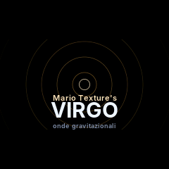
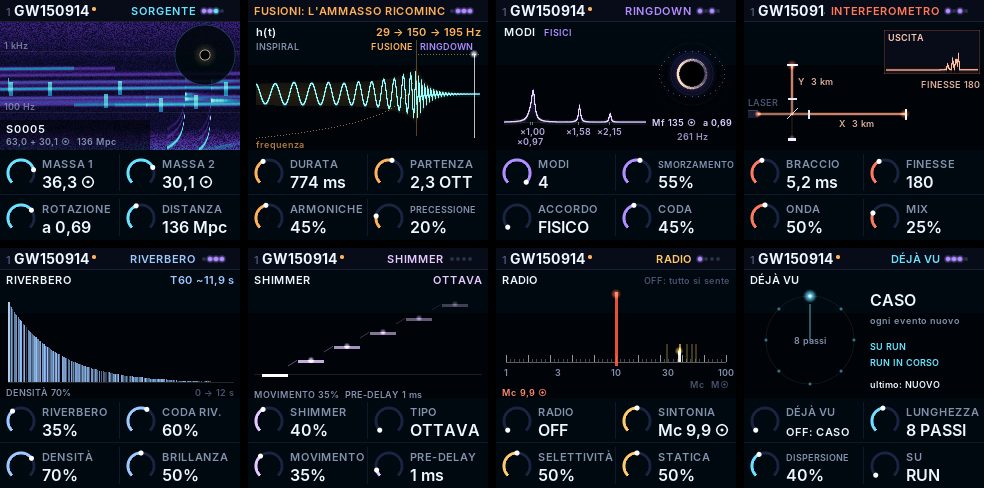

# Mario Texture's VIRGO

**A gravitational-wave synthesizer for the M-VAVE FM-1.** Every note is a black-hole merger: the inspiral chirp
rises, the two bodies merge, the remnant rings down in its quasi-normal modes. Four events at once, real detections
in the catalogue, a detector you can tune like a radio, a long dense reverb with a physics-flavoured shimmer.

*[Versione italiana: LEGGIMI.md](LEGGIMI.md)*

> The interface (screen and editor) is in **Italian**; this page explains what the names mean.

> Unofficial firmware: not made or endorsed by M-VAVE, not affiliated with the Virgo Collaboration. It installs and
> uninstalls over USB; to go back to the stock firmware, reinstall it with the official updater or the
> [FM-1 Firmware Hub](https://fm1.designburgapps.com). Use at your own risk.

Version **0.6**. Sister of [GRANA](https://github.com/mongio/grana-fm1), the granular firmware for the same device.

<p align="center"></p>
<p align="center"></p>

## Install

1. From the [Releases](../../releases) page download `virgo-editor-X.Y.html` and open it in **Chrome or Edge**
   (it needs Web MIDI and WebUSB).
2. Try VIRGO in the page's simulator: it is the same code that runs on the FM-1.
3. Connect the FM-1 over USB and press **Installa VIRGO**. Stay on the tab until it is done.
4. **VIRGO + Bluetooth** variant: the FM-1 connects by itself to a BLE-MIDI controller (SMC-Mixer and others).

VIRGO keeps its presets in a memory area of its own: GRANA's presets, samples and settings stay where they are and come
back when you reinstall GRANA. The user sample bank is shared with GRANA (VIRGO can play a sample on its CAMPIONE page).

The packages `virgo-X.Y.fwsc` and `virgo-X.Y-bluetooth.fwsc` in the Releases are for those who install with other tools.

**Recovery**: power the FM-1 on while holding **OCT−**: only the USB updater starts, and you can install again. For the
worst case use the first-aid kit in [GRANA's `rescue/`](https://github.com/mongio/grana-fm1/tree/main/rescue): it puts
GRANA back, then install VIRGO from its editor.

## The physics inside

- **Chirp**: frequency follows the coalescence law f ∝ (t_merger − t)^(−3/8), amplitude f^(2/3); the masses set the
  duration (through the chirp mass) and, when unequal, strengthen the higher modes (3,3), (4,4), (2,1).
- **Two polarisations**, h+ and h×, left and right; precession moves the sound in the stereo field.
- **Ringdown**: the quasi-normal modes of a spinning (Kerr) black hole, frequencies and damping from Berti, Cardoso and
  Will (2006), set by the spin.
- **Interferometer**: two delay arms with Fabry-Perot cavities, stretched in opposition by the wave; the output is the
  difference, like Virgo's dark port.
- **Detector noise**: seismic, thermal (with the suspensions' violin modes), quantum, glitches.
- **Sky**: distant binaries drifting slowly upward, like the white dwarfs LISA will hear.
- **Harmony from masses**: the mass ratio becomes an interval; spin can choose the scale (Phrygian → Lydian);
  hierarchical mergers walk the chord through the Tonnetz.
- **Engines**: ONDA (the modes), FM (the modes as operators, index ∝ v²), NEBULOSA (supersaws that close into one at
  the merger), PIEGA (West Coast wavefolder), CORDA (Karplus-Strong string plucked by the merger), VOCE (formants).
- **Radio**: every event has its station (chirp mass 1–100 M☉): static far away, a beating whistle near, the wave on it.
- **Déjà vu**: a Marbles-style random loop for notes, masses, distances, spin and RUN's rhythm.
- **Reverb + shimmer**: a dense Dattorro plate with a modulated tank and tails of minutes; the shimmer shifts each
  turn by an OCTAVE, a FIFTH, the KERR ratio of the remnant's first two modes, a REDSHIFT (down an octave) or a SPIRAL.
- **Output**: soft compressor, −1 dB limiter, stereo width and autopan.

## The pages

Each button opens its pages, pressed again it goes to the next; SELECT turns through all of them. KNOB 1–4 are the
page's four parameters. Names as on the screen.

| Button | Page | KNOB 1 | KNOB 2 | KNOB 3 | KNOB 4 |
| --- | --- | --- | --- | --- | --- |
| HOME | SORGENTE | MASSA 1 | MASSA 2 | ROTAZIONE | DISTANZA |
|  | ARMONIA | INTERVALLO | SCALA | TONICA | CHIRP |
|  | FUSIONI | GERARCHIA | GRAVITÀ | TONFO | SUB |
| SEL | CHIRP | DURATA | PARTENZA | ARMONICHE | PRECESSIONE |
|  | FINALE | FINALE | PICCO | SOSPENSIONE | APPRODO |
|  | MOTORE | MOTORE | ALGORITMO | (engine knob) | SATURAZIONE |
|  | EVENTO | FUSIONE | CONGELA | INVERSO | TUFFO |
| EDIT | RINGDOWN | MODI | SMORZAMENTO | ACCORDO | CODA |
| FX | FILTRO | TIPO | FREQUENZA | RISONANZA | DISTANZA |
|  | INTERFEROMETRO | BRACCIO | FINESSE | ONDA | MIX |
|  | RIVERBERO | RIVERBERO | CODA RIV. | DENSITÀ | BRILLANZA |
|  | SHIMMER | SHIMMER | TIPO | MOVIMENTO | PRE-DELAY |
|  | SPAZIO | CORO | ECO | TEMPO ECO | RITORNO |
| ENV | RUMORE | SISMICO | TERMICO | QUANTISTICO | GLITCH |
|  | RADIO | RADIO | SINTONIA | SELETTIVITÀ | STATICA |
| LFO | MOD A | SORGENTE | DESTINAZIONE | QUANTITÀ | VEL. LFO |
|  | MOD B | SORGENTE | DESTINAZIONE | QUANTITÀ | FORMA LFO |
|  | CIELO | DENSITÀ | DERIVA | BANDA | LIVELLO |
| ARP | RUN | TASSO | MASSE | DISTANZE | TEMPO |
|  | DÉJÀ VU | DÉJÀ VU | LUNGHEZZA | DISPERSIONE | SU |
|  | TURING | NOTE | CAMBIO | LUNGHEZZA | ESTENSIONE |
|  | RITMO | RITMO | PASSI | COLPI | ROTAZIONE |
| SEQ | CAMPIONE | SUONO | USO | LIVELLO | INIZIO |
| GLO | AUDIO | VOLUME | BPM | COMP/LIMIT | STEREO |
|  | MIDI | CLOCK | RICEVI | LEARN | CANCELLA |
|  | BT (Bluetooth only) | BLUETOOTH | DISPOSITIVO | MODO | AVVIO |

A few words: SORGENTE source · MASSA mass · ROTAZIONE spin · FUSIONI mergers · PARTENZA start (octaves below) ·
FINALE the chirp's last part (PICCO peak, SOSPENSIONE hold, APPRODO glide to the note) · MOTORE engine ·
SMORZAMENTO damping · CODA tail/sustain · EVENTO: FUSIONE when the masses merge (by themselves, when the key is
let go, or on REC), CONGELA freeze the ringdown while held, INVERSO the chance of a reversed event, TUFFO the plunge
time · TURING: RUN's notes from a Turing Machine shift register (scale degrees, or pure undertones 1/1…1/n) · RITMO:
euclidean rhythm or two-divider polyrhythm on RUN's grid · SCALA also DAL RESTO (the remnant's own mode ratios) and
ORBITALE (orbital resonances) · RUMORE noise · SINTONIA tuning · CIELO sky · RUN events arriving by
themselves · CAMPIONE sample · RICEVI receive.

Other controls: the keys play events (up to 4); HOME held = HOLD → HOLD INFINITO (frozen tails) → off, also the
sustain pedal (CC 64); ALGORITHM = the catalogue of real detections (GW150914, GW170817, GW190521, GW231123…);
PRESETS = 48 presets; SAVE = save (the knobs write the name); PLAY = RUN on/off; REC = one random event (with
FUSIONE A COMANDO: merge the waiting events);
OCT−/OCT+ = octave. MIDI over USB and the TRS jack: notes with velocity, CC 20–115 on the parameters (64 stays the sustain pedal), Program Change,
MIDI LEARN, clock in.

**SMC-Mixer** (Bluetooth version): faders MASSA 1, MASSA 2, ROTAZIONE, DURATA, INDICE, FREQUENZA, RIVERBERO, VOLUME;
knobs 1–4 the page, 5–8 ARMONICHE, SMORZAMENTO, SATURAZIONE, RISONANZA; SELECT 1–8 pages; MUTE 1 HOLD, MUTE 2 HOLD
INFINITO, MUTE 3–8 FINALE, RADIO, DÉJÀ VU, RIVERBERO, SHIMMER, SPAZIO; PLAY/STOP RUN; REC an event; BANK presets.

## Building

You need Linux x86-64 (or Docker), Python 3 with Pillow, the JieLi toolchain and three files of the JieLi AC79 SDK
(`uboot.boot`, `cfg_tool.bin`, `cfg/eq_cfg_hw.bin`, Apache-2.0, not included here).

```sh
tools/get_toolchain.sh                         # the JieLi toolchain in ~/.jieli
export AC79_SDK=~/fw-AC79_AIoT_SDK             # with cpu/wl82/tools/ inside
./build.sh --release 0.6 [--bt]                # build/virgo-0.6[-bluetooth].fwsc
APP_VER=0.6 sh web/build_virgo_wasm.sh         # web/virgo.wasm, the simulator (clang with wasm32)
python3 web/make_virgo_page.py 0.6             # web/virgo-editor.html (needs both packages; the screens are in docs/shots/)
```

Since 0.6 it also builds with the open LLVM toolchain for pi32v2
([jvitkauskas/pi32v2-llvm](https://github.com/jvitkauskas/pi32v2-llvm), release pi32v2-23.1.5-5) through the drop-in of
[pi32v2-isa](https://github.com/jvitkauskas/pi32v2-isa) (`tools/dropin/make_dropin.sh`): point `JIELI_TOOLCHAIN` at
the drop-in directory. The 0.6 release packages were built that way.

On a computer: `cc -O2 -DDINGHY_HOST -Ifirmware/src -Ifirmware/gen -o build/host/virgo firmware/src/virgo.c`, then
`build/host/virgo build/host/out script.txt` (screens as PPM and a WAV; the script format is in `tests/host.c`).

Version history (in Italian) in [LEGGIMI.md](LEGGIMI.md).

## Credits and licence

VIRGO is by **Mario Texture**, written with the help of Claude (Anthropic). It is free software under
**GPL-3.0-only** (`LICENSE`): whoever distributes a firmware built from here must give its source too, under the same
licence.

Built on [Dinghy](https://github.com/zvenson/dinghy) (zvenson), which uses the platform of
[Felucca](https://github.com/hugelton/Felucca) (Leo Kuroshita, Hügelton Instruments) as
[SLOOP](https://github.com/isod89/sloop-fm1) (isod89) carries it, by way of GRANA. Bluetooth:
[Optimist](https://github.com/w0ts/optimist)'s stack (w0ts), the glue after fm1-dock (Joakim Eriksson) and the
SMC-Mixer mode after [Hortator](https://github.com/DeadActive/hortator) (DeadActive). Font: Inter (SIL OFL 1.1).
Details in `LICENSING.md`.

"M-VAVE" and "FM-1" are trademarks of their owners.
